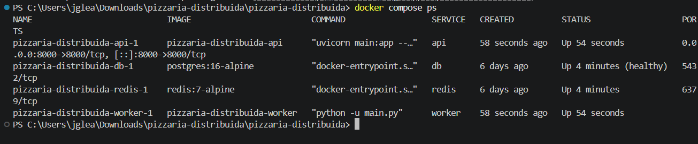
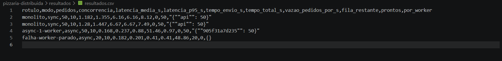
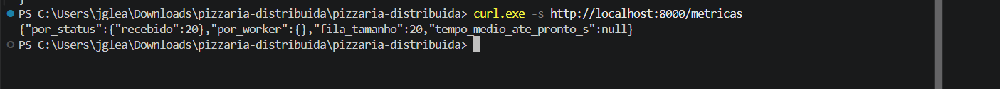
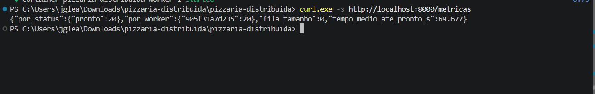

# Relatório Técnico — Pizzaria Distribuída

**Disciplina:** Computação Distribuída — UFMS  
**Grupo:** (Inserir os nomes dos componentes do grupo)  
**Data:** 08/11/2026  

---

## 1. Problema e objetivo

O problema escolhido consiste na gestão do fluxo de pedidos de uma pizzaria. Num sistema monolítico e síncrono tradicional, quando um cliente faz um pedido, a aplicação bloqueia até que a pizza esteja pronta, impedindo o atendimento de novos clientes e estrangulando o sistema em momentos de alta demanda.

O objetivo desta aplicação é resolver este gargalo através dos conceitos de Computação Distribuída. Criou-se um sistema orientado a eventos e mensagens assíncronas, onde a recepção do pedido é desacoplada do seu processamento (preparação da pizza). Isso permite que a aplicação continue a receber múltiplos pedidos simultaneamente com baixíssima latência.

---

## 2. Arquitetura e componentes

A arquitetura do sistema foi estruturada em microsserviços e componentes desacoplados executados em contêineres:

*   **API (FastAPI / Python):** Interface web responsável por receber as requisições REST dos clientes, validar as informações, salvar a intenção inicial no banco de dados e delegar a tarefa para a fila de mensagens.
*   **Worker (Python):** Processo em segundo plano que consome continuamente a fila. Simula o tempo de preparação da cozinha e atualiza o estado final no banco.
*   **Message Broker (Redis):** Fila de mensagens intermediária entre a API e os Workers.
*   **Banco de Dados (PostgreSQL):** Armazenamento relacional e persistente de todos os pedidos e seus estados (`recebido`, `preparando`, `pronto`).

---

## 3. Comunicação entre componentes

O sistema utiliza dois paradigmas de comunicação distintos:

1.  **Cliente-Servidor (REST / Síncrono):** O cliente faz um requisição HTTP `POST /pedidos` para a API e recebe um retorno imediato (`202 Accepted`) contendo o ID do pedido gerado.
2.  **Produtor-Consumidor (Fila de Mensagens / Assíncrono):** A API atua como *Producer*, inserindo os pedidos na fila do Redis (`r.lpush`). O Worker atua como *Consumer*, aguardando novos itens via chamada bloqueante (`r.brpop`). O desacoplamento é total: API e Worker não se conhecem nem conversam diretamente.

---

## 4. Execução (Docker)

O projeto é orquestrado localmente via Docker Compose, sem custos em nuvem:

*   Cada serviço possui suas dependências e arquivos de ambiente isolados.
*   O banco PostgreSQL possui um *healthcheck* para garantir que a API e os Workers só iniciem após a base de dados estar pronta para conexões.
*   **Comando de inicialização:**
    ```bash
    docker compose up --build -d
    ```

---

## 5. Persistência

*   **Onde os dados são mantidos:** Na tabela `pedidos` no PostgreSQL. Para evitar a perda de dados entre reinicializações dos contêineres, utilizou-se um volume nomeado (`pgdata`) atrelado ao serviço do banco.
*   **Acesso e modificações:** A API utiliza um pool de conexões (`ThreadedConnectionPool`) via `psycopg2` para gravação rápida inicial. O Worker acessa o PostgreSQL para atualizar os campos `status`, `worker` (ID do contêiner que processou) e `finalizado_em`.

---

## 6. Experimento 1 — Síncrono vs Assíncrono

*   **Objetivo:** Demonstrar o impacto do desacoplamento na latência percebida pelo cliente.
*   **Método:** Utilização do script `experimento.py` enviando 50 requisições concorrentes (`--n 50 --concorrencia 10`), comparando o modo síncrono com o assíncrono.
*   **Resultados e Interpretação:**
    *   **Modo Síncrono (`monolito`):** A latência média para o cliente aceitar o pedido subiu para **~1.28s**, pois a resposta ficou retida até o processamento simular a conclusão.
    *   **Modo Assíncrono (`async-1-worker`):** A latência média caiu para **~0.168s** (redução drástica). A API respondeu instantaneamente enquanto a fila foi processada em segundo plano.

---

## 7. Experimento 2 — Escalabilidade de workers

*(Seção mantida para registro analítico do comportamento do worker individual sob carga).*
Ao utilizar a arquitetura assíncrona com 1 Worker, observou-se que embora a API aceite os pedidos imediatamente (alta disponibilidade), a taxa de vazão do processamento da fila fica limitada pela capacidade do worker (aproximadamente 1 pedido/segundo). 

---

## 8. Experimento de falha — Queda do worker

*   **Cenário:** Durante a execução, o contêiner do worker foi derrubado intencionalmente (`docker stop worker`). Foram enviados 20 novos pedidos e, em seguida, o worker foi religado (`docker start worker`).
*   **Comportamento Observado:**
    1.  Com o Worker fora do ar, a API continuou **100% disponível**, recebendo e respondendo aos 20 pedidos sem erros.
    2.  As métricas da API via `curl.exe -s http://localhost:8000/metricas` mostraram os 20 pedidos acumulados na fila (`"recebido": 20`, `"fila_tamanho": 20`).
    3.  Ao iniciar o worker novamente, ele conectou-se ao Redis e drenou a fila completamente, atualizando todos os 20 pedidos para o status `"pronto"` (`"fila_tamanho": 0`).
*   **Interpretação:** Comprovou-se a resiliência e a tolerância a falhas (*self-healing*) da arquitetura orientada a eventos.

---

## 9. Evidências

*   **Ambiente Docker (`docker compose ps`):**
     *(Substituir pelo caminho do print no projeto)*
*   **Métricas Quantitativas (`resultados.csv`):**
    
*   **Falha (Worker offline / Fila cheia):**
    
*   **Recuperação (Worker online / Fila drenada):**
    

---

## 10. Limitações e melhorias

*   **Limitação do Redis:** O Redis opera prioritariamente em memória. Uma queda bruta do serviço do Redis antes da leitura dos Workers pode ocasionar a perda de pedidos pendentes na fila.
*   **Falta de Dead Letter Queue (DLQ):** Falhas não tratadas na execução do código do Worker deixam o status do pedido estagnado em `recebido` indefinidamente.
*   **Melhorias Futuras:** Implementar confirmação explícita de mensagem (*ACK/NACK*) com um broker como RabbitMQ/Kafka e configurar uma fila de mensagens mortas (DLQ) para reprocessamento.

---

## 11. Gestão com Trello

*(Quadro atualizado com o ciclo de vida do projeto, organizando as etapas de arquitetura, scripts de experimentos, prints de evidências e relatório final).*

 *(Anexar o print do Trello)*